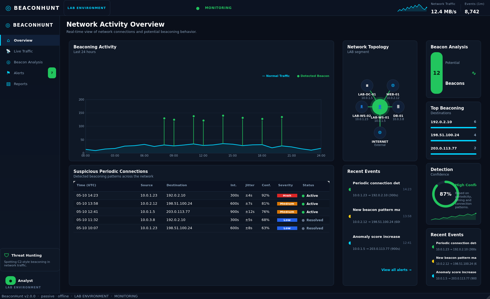
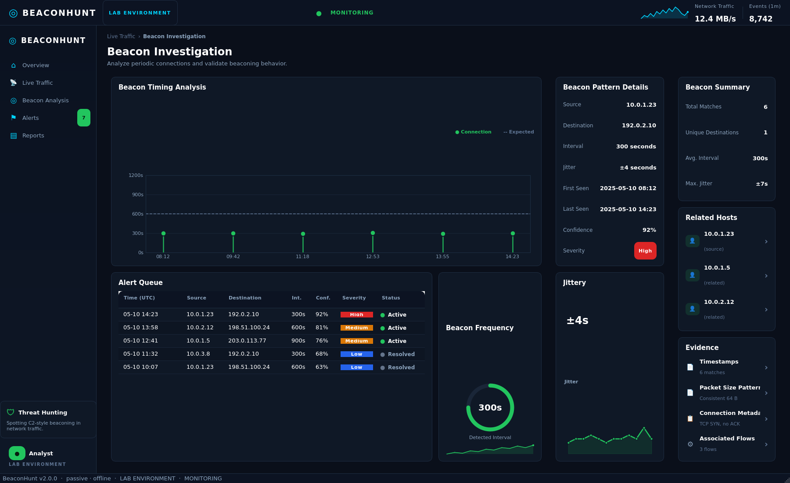
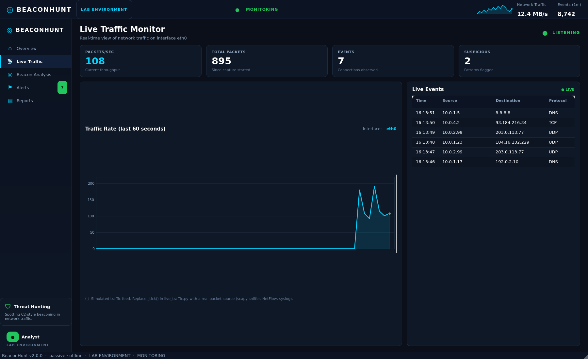
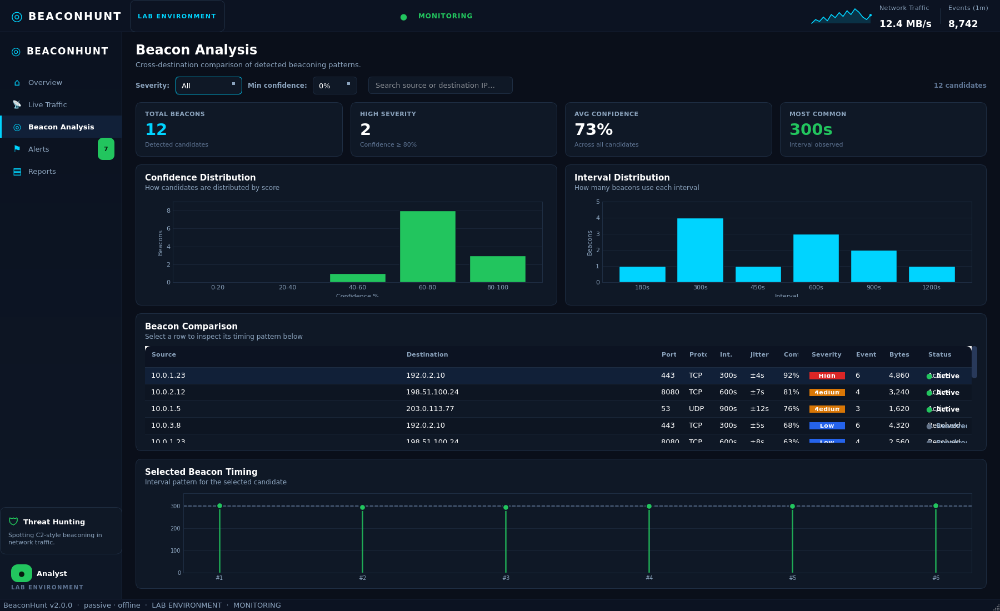
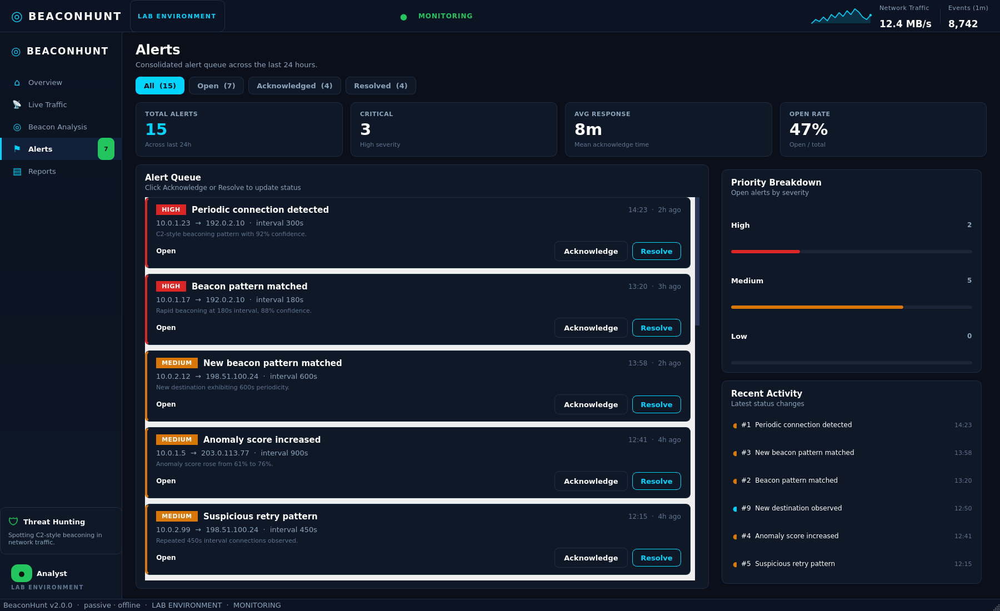
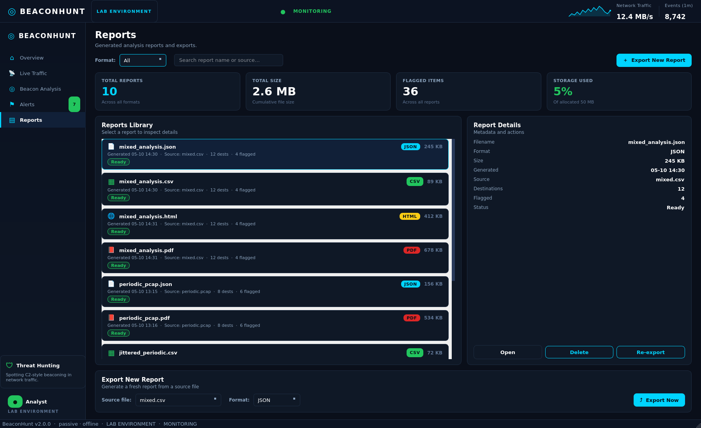

# BeaconHunt — Redesigned Dark SOC Dashboard (v2.0.0)

A visual redesign of the BeaconHunt desktop GUI to match the
**BEACONHUNT Cybersecurity Dashboard** reference mockup — a dark,
tech-themed SOC monitoring platform for detecting C2 beaconing behavior
in network traffic.

The redesigned GUI ships as a standalone, runnable PySide6 application
that reproduces both views from the reference image plus four bonus
interactive pages — Live Traffic Monitor, Beacon Analysis, Alerts, and
Reports:

1. **Network Activity Overview** — 24-hour beaconing activity chart,
   suspicious periodic connections table, network topology widget,
   recent events feed, and a right sidebar with potential-beacons count,
   top destinations, and a detection-confidence donut.
2. **Beacon Investigation** — beacon timing analysis lollipop chart,
   alert queue table, beacon-frequency donut, beacon pattern details
   panel, jitter waveform, and a right sidebar with beacon summary,
   related hosts, and evidence rows.
3. **Live Traffic Monitor** — animated rolling 60-second traffic chart
   that updates every second, a live events feed that adds new entries
   in real time, and four live stat cards (packets/sec, total packets,
   events, suspicious). The page is driven by simulated data — replace
   the `_tick()` method in `live_traffic.py` with a real packet source
   (scapy sniffer, NetFlow collector, syslog feed) to wire it to live
   traffic.
4. **Beacon Analysis** — cross-destination comparison view with a
   filter bar (severity, min-confidence, IP search), four summary stat
   cards (total / high-severity / avg confidence / most common
   interval), two distribution charts (confidence histogram + interval
   distribution), an interactive comparison table (12 mock beacon
   candidates with severity pills + status dots), and a mini timing
   lollipop chart that updates when you select a row.
5. **Alerts** — consolidated alert queue with filter tabs
   (All / Open / Acknowledged / Resolved, each showing its count),
   four stat cards (total / critical / avg response / open rate), an
   alert card list with severity pills, source → destination with
   interval, timestamps, and working **Acknowledge** / **Resolve**
   buttons that update the alert's status and refresh the sidebar
   badge count live. A right sidebar shows a priority breakdown
   (visual bars for High/Medium/Low open alerts) and a recent activity
   log.
6. **Reports** — generated report library with a filter bar (format
   dropdown + search), four stat cards (total reports / total size /
   flagged items / storage used), a scrollable reports list (10 mock
   reports across JSON / CSV / HTML / PDF / Text formats with format
   icons, pills, metadata, and status badges), a details panel that
   updates when you select a report (with working **Open** / **Delete**
   / **Re-export** buttons), and an "Export New Report" section at the
   bottom with source/format dropdowns and an **Export Now** button
   that prepends a new mock report to the list.

All mock data mirrors the reference screenshot (same IPs, intervals,
jitter values, confidence percentages, and severity levels). In the
full BeaconHunt application, these values would come from the analysis
engine (`beaconhunt.analysis.engine.AnalysisReport`).

## Screenshots

| Network Activity Overview | Beacon Investigation |
| --- | --- |
|  |  |

| Live Traffic Monitor | Beacon Analysis |
| --- | --- |
|  |  |

| Alerts | Reports |
| --- | --- |
|  |  |

## What was redesigned

### Color palette
A deep navy/charcoal background (`#0A0F1A`) with raised panel cards
(`#0F1826`) and 1px borders (`#1E2D42`). The single accent palette is:

| Token | Hex | Use |
| --- | --- | --- |
| Cyan | `#00D4FF` | primary accent, links, active nav, sparklines, normal-traffic line |
| Green | `#22C55E` | status dots, topology edges, confidence donuts, detected-beacon markers |
| Red | `#DC2626` | High severity pills |
| Amber | `#D97706` | Medium severity pills |
| Blue | `#2563EB` | Low severity pills |
| White | `#FFFFFF` | primary text |
| Muted | `#8BA3BD` | secondary text |

This replaces the original light/dark dual-theme palette with a single
dark SOC palette that matches the reference.

### Layout
- **Top header bar** (full width, ~58px): logo glyph + "BEACONHUNT"
  wordmark, "LAB ENVIRONMENT" outlined pill, green "MONITORING"
  indicator, mini cyan traffic sparkline, and two stat blocks
  ("Network Traffic 12.4 MB/s" and "Events (1m) 8,742") separated by a
  vertical divider.
- **Left sidebar** (fixed 220px): Overview, Live Traffic, Beacon
  Analysis, Alerts (with green "7" badge), Reports nav items, plus a
  bottom-pinned "Threat Hunting" promo card and an "Analyst /
  LAB ENVIRONMENT" footer.
- **Content stack**: 6 pages — Network Activity Overview, Beacon
  Investigation, plus placeholder pages for Live Traffic, Beacon
  Analysis, Alerts, Reports so the sidebar nav works end-to-end.

### Custom widgets
- **`DonutGauge`** — circular progress ring with a centered label
  (used for Detection Confidence 87% and Beacon Frequency 300s).
- **`Sparkline`** — tiny inline line chart with optional filled area
  (used in the header, the confidence card, and the beacon frequency
  card).
- **`TopologyWidget`** — custom QPainter star topology with a center
  node connected to 5 surrounding nodes (LAB-DC-01, WEB-01, LAB-WS-02,
  DB-01, INTERNET) via glowing green lines.
- **`ActivityChart`** — matplotlib 24-hour beaconing activity chart:
  cyan noisy baseline with tall green beacon-detection spikes.
- **`TimingChart`** — matplotlib lollipop chart with green stems, dot
  tops, and a dashed expected-interval reference line.
- **`JitterChart`** — small green jitter waveform with a spike near the
  end.

## How to run

```bash
# 1. Install dependencies
pip install -r requirements.txt

# 2. Run the app
python run.py
# or:
python -m beaconhunt.app
```

The application opens at 1600×1000 and is resizable down to 1280×800.

## File structure

```text
BeaconHunt-redesigned/
├── README.md
├── requirements.txt
├── run.py
├── BeaconHunt_redesigned_overview.png        # screenshot
├── BeaconHunt_redesigned_investigation.png   # screenshot
├── BeaconHunt_redesigned_live_traffic.png    # screenshot
├── BeaconHunt_redesigned_beacon_analysis.png # screenshot
├── BeaconHunt_redesigned_alerts.png          # screenshot
├── BeaconHunt_redesigned_reports.png         # screenshot
└── beaconhunt/
    ├── __init__.py                # __version__ = "2.0.0"
    ├── app.py                     # QApplication entry point
    └── ui/
        ├── __init__.py
        ├── styles.py              # dark SOC palette + global QSS
        ├── mock_data.py           # static values mirroring the reference
        ├── widgets.py             # DonutGauge, Sparkline, TopologyWidget,
        │                          #   ActivityChart, TimingChart, JitterChart
        ├── sidebar.py             # left nav + Threat Hunting card + alerts badge
        ├── dashboard.py           # Network Activity Overview page
        ├── investigation.py       # Beacon Investigation page
        ├── live_traffic.py        # animated Live Traffic Monitor page
        ├── beacon_analysis.py     # cross-destination Beacon Analysis page
        ├── alerts.py              # interactive Alerts queue page
        ├── reports.py             # report library + export/delete actions
        └── main_window.py         # header bar + sidebar + stacked pages
```

## Integrating with the original BeaconHunt project

The redesigned UI files are drop-in replacements for the original
`beaconhunt/ui/*.py` files. To integrate:

1. Copy the contents of `beaconhunt/ui/` from this package into the
   original BeaconHunt project's `beaconhunt/ui/` directory
   (overwriting `styles.py`, `sidebar.py`, `dashboard.py`,
   `main_window.py`, `__init__.py`).
2. Add the new files `widgets.py`, `mock_data.py`, and
   `investigation.py`.
3. The original `details_panel.py`, `results_table.py`,
   `import_panel.py`, and `progress_dialog.py` files are not used by
   the redesigned main window — keep them for back-compat or remove
   them.
4. To wire the redesigned dashboard to live analysis data, replace the
   imports from `mock_data` with calls to the analysis engine's
   `AnalysisReport` results. The mock data structures
   (`SuspiciousRow`, `EventItem`, `TopDest`, `PatternDetail`,
   `EvidenceRow`, `RelatedHost`, `TopologyNode`) map cleanly onto the
   engine's `DestinationResult` objects.

## Notes on visual fidelity

The reference screenshot appears to be rendered at a high resolution
(~1920px wide). At the default 1600×1000 window size, some long text
values (timestamps, "Beacon Pattern Details" titles) may be visually
clipped. To see the full layout with breathing room, resize the window
to 1800×1100 or larger. The original BeaconHunt project supported a
light/dark theme toggle; this redesign ships only the dark SOC palette
to match the reference, but the `styles.py` module keeps the
`set_theme` / `toggle_theme` / `register_listener` API as no-ops so
existing code continues to work.

## Credits

Redesign based on the BEACONHUNT Cybersecurity Dashboard reference
mockup. Original BeaconHunt project by **Ashar** (v1.0.0).
