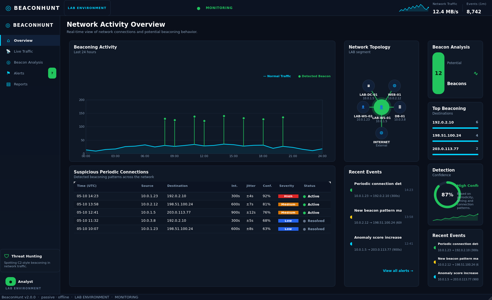
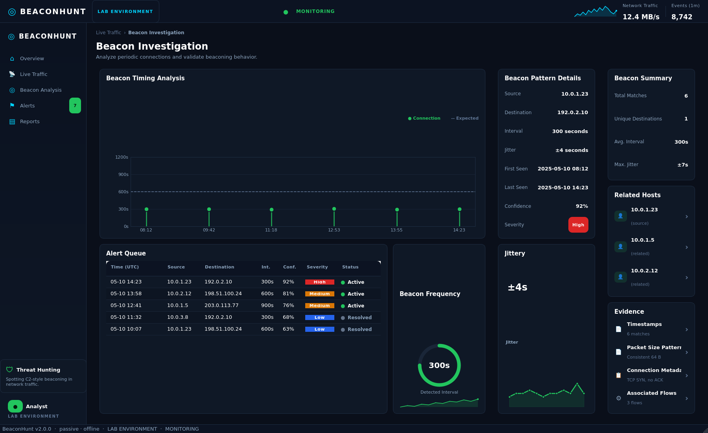
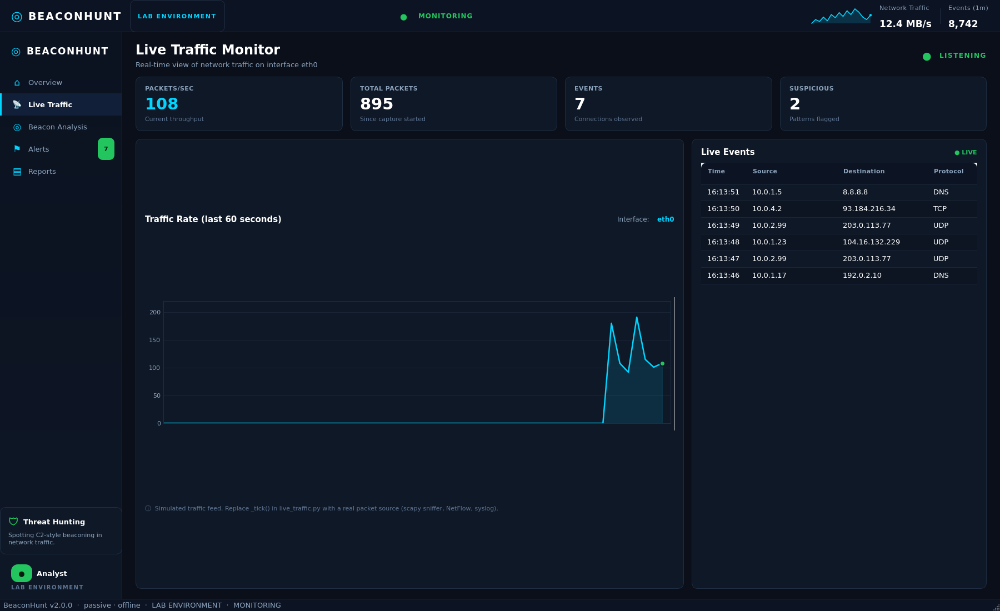
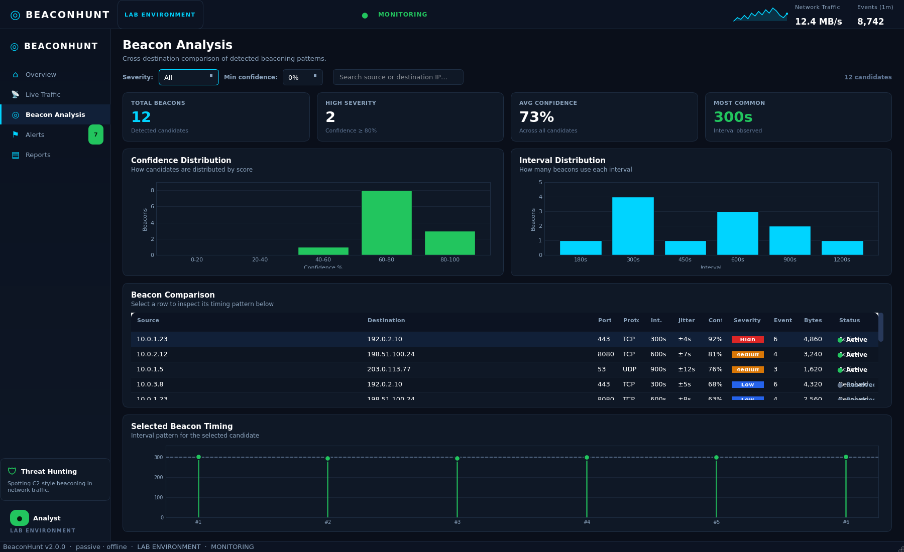
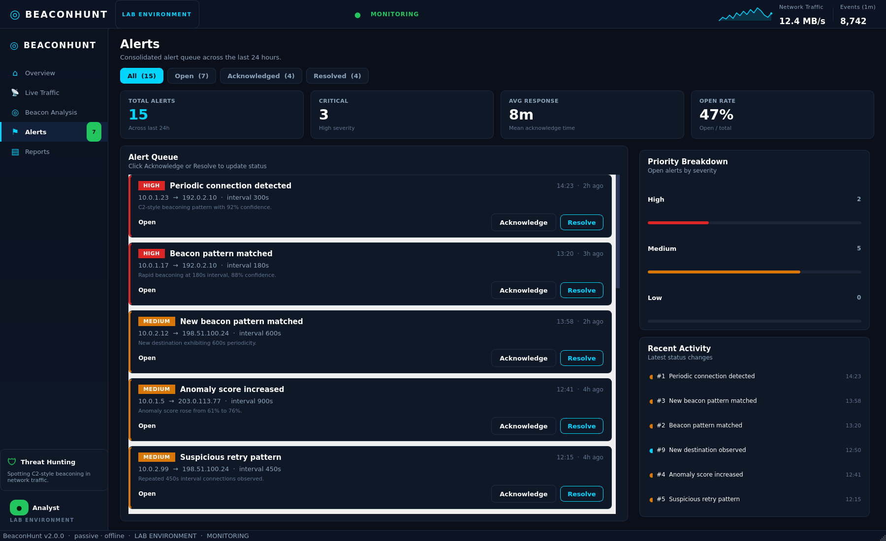
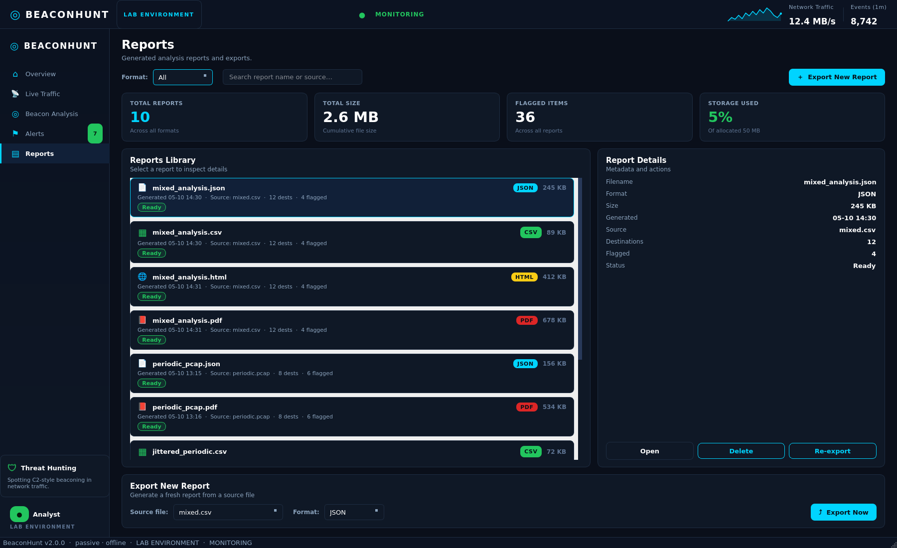

# 🔍 BeaconHunt – Offline C2 Beaconing Detection & Network Traffic Analysis

**BeaconHunt** is a desktop-based network traffic analysis and cybersecurity monitoring application designed to help security analysts identify suspicious periodic communication patterns that may indicate Command-and-Control (C2) beaconing activity.

It provides a modern Security Operations Center (SOC)-style dashboard for investigating network activity, analyzing beacon patterns, monitoring alerts, and reviewing security reports.

---

## 🚀 Features

### 1. Network Activity Overview
- Overview of suspicious network connections.
- 24-hour network activity visualization.
- Detection confidence indicators.
- Network topology visualization.
- Recent security events.
- Identification of potential beaconing destinations.

### 2. Beacon Investigation
- Detailed beacon communication analysis.
- Beacon interval and jitter analysis.
- Detection confidence scoring.
- Timing analysis visualization.
- Related host information.
- Evidence-based investigation panels.

### 3. Live Traffic Monitor
- Animated network traffic visualization.
- Rolling 60-second traffic chart.
- Live event feed simulation.
- Packet statistics.
- Suspicious activity indicators.

### 4. Beacon Analysis
- Cross-destination beacon comparison.
- Severity-based filtering.
- Confidence score filtering.
- Source and destination IP analysis.
- Beacon interval distribution.
- Interactive beacon comparison table.

### 5. Security Alerts
- Centralized security alert management.
- High, Medium, and Low severity classifications.
- Alert filtering by status.
- Acknowledge and Resolve actions.
- Alert activity tracking.

### 6. Reports Management
- Report library.
- JSON, CSV, HTML, PDF, and Text format options.
- Report filtering and searching.
- Report details.
- Export, open, and delete actions.

---

## 🛠️ Technologies Used

| Technology | Purpose |
|---|---|
| Python 3.11+ | Main programming language |
| PySide6 | Desktop graphical user interface |
| NumPy | Numerical calculations |
| Matplotlib | Network and beacon visualizations |
| Qt | Desktop application framework |

---

## 📋 Requirements

Before installing BeaconHunt, make sure you have:

- Python 3.11 or newer.
- pip (Python package manager).
- Git (optional, for cloning the repository).

---

## 📥 Installation Guide

### Step 1: Clone the Repository

Open your terminal or command prompt and run:

```bash
git clone https://github.com/YOUR-USERNAME/YOUR-REPOSITORY.git
```

Navigate into the downloaded project:

```bash
cd YOUR-REPOSITORY
```

### Step 2: Navigate to the Application Directory

The runnable application is located inside the `BeaconHunt-redesigned` directory.

```bash
cd BeaconHunt-redesigned
```

### Step 3: Create a Virtual Environment (Recommended)

Create a virtual environment:

```bash
python -m venv venv
```

Activate it.

**Windows:**

```bash
venv\Scripts\activate
```

**Linux / macOS:**

```bash
source venv/bin/activate
```

### Step 4: Install Dependencies

Install all required Python packages:

```bash
pip install -r requirements.txt
```

This installs:

- PySide6
- NumPy
- Matplotlib

---

## ▶️ How to Run BeaconHunt

Once the dependencies have been installed, run:

```bash
python run.py
```

Alternatively, launch the application using:

```bash
python -m beaconhunt.app
```

The BeaconHunt desktop application should now open.

---

## 📁 Project Structure

```text
BeaconHunt/
│
├── LICENSE
├── README.md
│
└── BeaconHunt-redesigned/
    │
    ├── README.md
    ├── requirements.txt
    ├── run.py
    ├── logo.png
    │
    ├── BeaconHunt_redesigned_overview.png
    ├── BeaconHunt_redesigned_investigation.png
    ├── BeaconHunt_redesigned_live_traffic.png
    ├── BeaconHunt_redesigned_beacon_analysis.png
    ├── BeaconHunt_redesigned_alerts.png
    ├── BeaconHunt_redesigned_reports.png
    │
    └── beaconhunt/
        │
        ├── __init__.py
        ├── app.py
        │
        └── ui/
            ├── __init__.py
            ├── alerts.py
            ├── beacon_analysis.py
            ├── dashboard.py
            ├── investigation.py
            ├── live_traffic.py
            ├── main_window.py
            ├── mock_data.py
            ├── reports.py
            ├── sidebar.py
            ├── styles.py
            └── widgets.py
```

---

## 📸 Application Screenshots

### Network Activity Overview



### Beacon Investigation



### Live Traffic Monitor



### Beacon Analysis



### Security Alerts



### Reports Management



---

## ⚙️ Configuration & Development Notes

- The redesigned dashboard currently uses predefined mock data.
- Live Traffic Monitor uses simulated traffic events.
- Dashboard statistics and beacon information are populated through `mock_data.py`.
- The application is structured so that the dashboard can be integrated with a network traffic analysis backend.
- The full PCAP analysis and detection backend is not included in this redesigned standalone package.

For live network analysis, the dashboard needs to be connected to an appropriate packet capture or traffic analysis engine.

---

## 🐛 Troubleshooting

**1. Python is not recognized**

Make sure Python 3.11 or newer is installed and added to your system PATH.

**2. ModuleNotFoundError**

Install the required dependencies again:

```bash
pip install -r requirements.txt
```

**3. Application does not launch**

Check your Python version:

```bash
python --version
```

Make sure you are running commands from inside the `BeaconHunt-redesigned` directory.

**4. GUI-related errors**

Try upgrading PySide6:

```bash
pip install --upgrade PySide6
```

---

## 🔮 Future Improvements

Potential future enhancements include:

- Real-time packet capture and network monitoring.
- PCAP file importing and analysis.
- Automated C2 beacon detection.
- Advanced anomaly detection.
- Integration with Scapy.
- Improved threat intelligence integration.
- Automated security report generation.

---

## 🔐 License

This project is distributed under the license included in the repository. See the `LICENSE` file for details.

---

## 👨‍💻 Author

**Ashar**

BeaconHunt – Offline C2 Beaconing Detection & Network Traffic Analysis.

---

⭐ If you find this project useful, consider giving the repository a star on GitHub!
